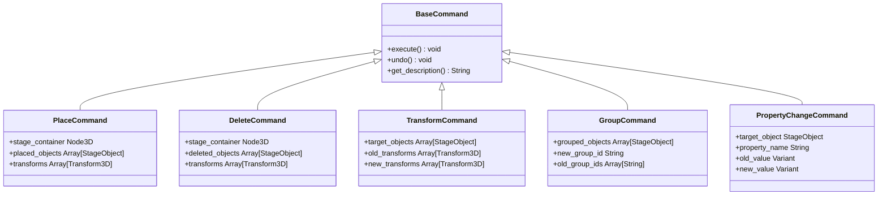

# Stage-Builder Architecture Specification

## 1. Overview & Core Philosophy
**Stage-Builder** is a high-performance native desktop 3D simulator designed for event production engineers, lighting designers, audio techs, and stage managers to design stages for concerts, festivals, corporate events, and club nights.

### Key Architectural Constraints
* **Native Desktop Only**: No webview, Electron, or browser technology. Built with Godot 4.x (GDScript) using the Forward+ rendering method with automated Compatibility fallback.
* **Target Platforms**: Windows 10/11 (x86_64) and macOS (Apple Silicon + Intel universal).
* **Physical Scale**: Exactly **1 Godot unit = 1 meter**. All asset dimensions in meters and weights in kilograms represent real-world physical values.
* **Extensible Data-Driven Catalog**: Adding new equipment requires only editing `data/catalog.json` and pointing to a model or generator name—zero code modifications required.

---

## 2. Directory Structure

```
Stage-Builder/
├── .gitignore                     # Godot cache, .godot/, .venv/, temp project files
├── .venv/                         # Python 3 virtual environment for tooling & validation
├── project.godot                  # Godot 4 project configuration & Autoload registrations
├── export_presets.cfg             # Windows x86_64 and macOS universal build configurations
├── icon.svg                       # Vector application icon
├── README.md                      # Comprehensive developer, build & user guide
├── data/
│   └── catalog.json               # Canonical equipment catalog with 27 items & snap points
├── docs/
│   └── architecture.md            # This document
├── scenes/
│   ├── main.tscn                  # Application root (UI shell + 3D Viewport container)
│   └── test/
│       ├── test_performance.tscn  # 5,000-object instancing stress test scene
│       └── test_runner.tscn       # Automated headless integration test suite
└── scripts/
    ├── core/
    │   ├── app_state.gd           # Global application state, active selection & signals
    │   ├── catalog_manager.gd     # JSON catalog loader & asset factory singleton
    │   ├── command_manager.gd     # Command-pattern undo/redo stack manager
    │   ├── commands.gd            # Place, Delete, Transform, Group, and Property commands
    │   ├── project_serializer.gd  # .stagebuilder JSON save/load/autosave & recent files
    │   ├── platform_utils.gd      # OS detection (Cmd on macOS vs Ctrl on Windows, trackpads)
    │   └── stage_object.gd        # Runtime StageObject class with metadata & collision
    ├── ui/
    │   ├── main_ui.gd             # Top-level UI layout, shortcuts & dialog controller
    │   ├── menu_bar.gd            # File, Edit, View, Ground, Help menu bar
    │   ├── asset_panel.gd         # Left asset catalog browser with live search & filters
    │   ├── properties_panel.gd    # Right inspector (transform, dimensions, weight, notes)
    │   └── status_bar.gd          # Bottom info bar with grid/snap toggles and FPS counter
    ├── viewport/
    │   ├── stage_viewport.gd      # 3D raycasting, placement preview, box select, shortcuts
    │   ├── stage_camera.gd        # Orbit, Pan, Zoom, WASD Fly mode, Trackpad & Quick Views
    │   ├── grid_plane.gd          # Dynamic 1m minor + 5m major lines & colored axes
    │   ├── transform_gizmo.gd     # Interactive 3D translation & rotation handles
    │   ├── snap_system.gd         # Grid snap & snap-point-to-snap-point resolver
    │   └── ground_environment.gd  # Concrete, Grass, Parking Lot materials & dusk sky
    └── tools/
        ├── mesh_generators.gd     # Procedural primitive mesh builders for 27 assets
        └── catalog_validator.py   # Python validation script for catalog schema
```

---

## 3. Subsystem Architecture

### 3.1 Data-Driven Asset Catalog
Equipment definitions reside in `/data/catalog.json`. Every asset specifies:
- `id`: Unique identifier (e.g. `truss_straight_2m`, `staging_deck_2x1`)
- `name`: Clean generic name (no copyrighted brand names)
- `category`: Truss, Staging, Audio, Lighting, Video, Power, DJ, Crowd
- `dimensions`: `{ x, y, z }` in meters
- `weight_kg`: Physical weight in kilograms
- `mesh_generator`: Named procedural builder in `MeshGenerators` or `model_path`
- `snap_points`: Array of `{ pos: [x,y,z], normal: [x,y,z], tag: "..." }`
- `tags`: Array of search keywords

#### Adding a New Asset (Zero Code Changes)
To add a new asset, simply append a JSON block to `data/catalog.json`:
```json
{
  "id": "truss_straight_4m",
  "name": "Box Truss 4m",
  "category": "Truss",
  "dimensions": { "x": 0.3, "y": 0.3, "z": 4.0 },
  "weight_kg": 27.0,
  "mesh_generator": "gen_truss_straight",
  "tags": ["truss", "rigging", "aluminum", "f34", "30cm"],
  "snap_points": [
    { "pos": [0.0, 0.0, -2.0], "normal": [0.0, 0.0, -1.0], "tag": "truss_30" },
    { "pos": [0.0, 0.0, 2.0], "normal": [0.0, 0.0, 1.0], "tag": "truss_30" }
  ]
}
```
`CatalogManager` reloads automatically, updates the category tree and search index, and instantiates the new asset immediately.

---

### 3.2 Command Pattern (Undo / Redo)
All scene modifications in Stage-Builder execute through command objects inheriting from `BaseCommand` in `scripts/core/commands.gd`:



`CommandManager` maintains a bounded undo stack (100 operations) and redo stack, emitting `history_changed` to dynamically enable or disable Menu Bar entries.

---

### 3.3 Snapping System
Stage-Builder provides dual-layer snapping via `scripts/viewport/snap_system.gd`:

1. **Snap-Point-to-Snap-Point (Priority 1)**:
   - When an object is moved or placed, its global snap points are checked against all nearby stage objects.
   - If a compatible tag matches (e.g. `truss_30` to `truss_30`, or `deck_edge_1m` to `deck_edge_2m`) within `AppState.snap_threshold` (0.35m default), the position automatically snaps to perfect geometric alignment.
2. **Grid Snapping (Priority 2)**:
   - Snaps coordinate components to the configured step (`0.25m`, `0.50m`, or `1.00m`).
   - Y-elevation snaps to modular riser increments (0.1m / 0.2m / 0.4m).

---

### 3.4 Camera Navigation & Mac Trackpad Support
`StageCamera` implements standard CAD / 3D DCC controls:
- **Orbit**: Middle Mouse Button OR `Alt + Left Mouse Button`
- **Pan**: `Shift + Middle Mouse Button` OR macOS two-finger scroll gesture (`InputEventPanGesture`)
- **Zoom**: Mouse scroll wheel OR macOS pinch-to-zoom (`InputEventMagnifyGesture`)
- **Fly Mode**: Hold `Right Mouse Button` + `WASD` (forward/back/strafe), `Q`/`E` (down/up), `Shift` (speed boost).
- **Quick Views**: Top (Numpad 7), Front (Numpad 1), Side (Numpad 3), Perspective (Numpad 0).
- **Framing**: `F` centers and frames the camera on the active selection.

---

### 3.5 3D Transform Gizmo
`TransformGizmo` provides interactive 3D manipulators rendered directly in the scene with depth-test prioritization:
- Red Arrow: X-axis translation
- Green Arrow: Y-axis translation
- Blue Arrow: Z-axis translation
- Yellow Quad: Horizontal XZ ground-plane translation
- Cyan Ring: Y-axis rotation (supports 15° angular snapping when grid snap is enabled)

Dragging handles calculates ray-plane intersections in world space, updates the selected objects' positions interactively, and executes a `TransformCommand` on release for complete undo/redo support.

---

### 3.6 Performance Strategy (5,000+ Objects at 60 FPS)
To achieve rock-solid 60 FPS with large stadium/festival stage setups:
1. **Material Sharing**: `MeshGenerators` shares instantiated `StandardMaterial3D` instances across all identical equipment parts, allowing Godot's Forward+ renderer to batch draw calls.
2. **MultiMesh Instancing for Mass Crowds**: The `crowd_block` asset and `test_performance.tscn` leverage `MultiMeshInstance3D`, rendering 100+ to 5,000 human figures in a single hardware draw call with negligible CPU overhead.
3. **Collision Optimization**: Physics picking uses single simplified `BoxShape3D` volumes on dedicated collision layers, preventing complex mesh triangle queries during viewport raycasting.

---

## 4. File Format (`.stagebuilder`)
Projects are saved as clean human-readable JSON files:
```json
{
  "version": "1.0.0",
  "project_name": "Summer Festival Main Stage",
  "timestamp": "2026-11-02T00:15:00",
  "ground": "grass",
  "camera": {
    "position": [0.0, 8.0, 16.0],
    "rotation": [-0.5, 0.0, 0.0]
  },
  "objects": [
    {
      "catalog_id": "staging_deck_2x1",
      "instance_id": "obj_1730501234_4201",
      "name": "Stage Deck 2x1m",
      "category": "Staging",
      "dimensions": { "x": 2.0, "y": 0.4, "z": 1.0 },
      "weight_kg": 32.0,
      "custom_notes": "Front row center deck",
      "group_id": "main_stage_riser",
      "transform": {
        "basis": [[1,0,0], [0,1,0], [0,0,1]],
        "origin": [0.0, 0.4, 0.0]
      }
    }
  ]
}
```
Autosave writes to `user://autosave.stagebuilder` every 120 seconds if changes have occurred.

