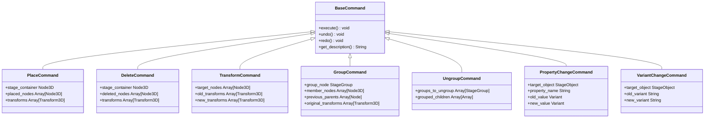

# Stage-Builder Architecture Specification

## 1. Overview & Core Philosophy
**Stage-Builder** is a high-performance native desktop 3D simulator designed for event production engineers, lighting designers, audio techs, and stage managers to design stages for concerts, festivals, corporate events, and club nights.

### Key Architectural Constraints
* **Native Desktop Only**: No webview, Electron, or browser technology. Built with Godot 4.x (GDScript) using the Forward+ rendering method with automated Compatibility fallback.
* **Target Platforms**: Windows 10/11 (x86_64) and macOS (Apple Silicon + Intel universal).
* **Physical Scale**: Exactly **1 Godot unit = 1 meter**. All asset dimensions in meters and weights in kilograms represent real-world physical values.
* **Extensible Data-Driven Catalog**: Adding new equipment requires only editing `data/catalog.json` and pointing to a model or generator name—zero code modifications required.
* **User Asset Import Pipeline**: Import external GLTF/GLB models with automatic triangle and bounding box verification, saved outside the repository in `user://imported_assets/`.

---

## 2. Directory Structure

```
Stage-Builder/
├── .gitignore                     # Godot cache, .godot/, .venv/, temp project files
├── .venv/                         # Python 3 virtual environment for tooling & validation
├── project.godot                  # Godot 4 project configuration & Autoload registrations
├── export_presets.cfg             # Windows x86_64 and macOS universal build configurations
├── icon.svg                       # Vector application icon
├── README.md                      # Comprehensive developer, build & user guide
├── data/
│   ├── catalog.json               # Canonical equipment catalog with 146 items, 175 snaps, 104 variants
│   └── catalog.schema.json        # JSON Schema for equipment validation
├── docs/
│   ├── architecture.md            # This architectural specification
│   └── asset_pipeline.md          # 5-minute external 3D asset import guide
├── scenes/
│   ├── main.tscn                  # Application root (UI shell + 3D Viewport container)
│   └── test/
│       ├── test_performance.tscn  # 5,000-object instancing stress test scene
│       └── test_runner.tscn       # Automated headless integration test suite
└── scripts/
    ├── core/
    │   ├── app_state.gd           # Global application state, active selection & signals
    │   ├── catalog_manager.gd     # JSON catalog loader, user imports, favorites, recents, Phase 1 aliases
    │   ├── command_manager.gd     # Command-pattern undo/redo stack manager
    │   ├── commands.gd            # Place, Delete, Transform, Group, Property, and VariantChange commands
    │   ├── project_serializer.gd  # .stagebuilder JSON save/load/autosave & recent files (backward compat)
    │   ├── platform_utils.gd      # OS detection (Cmd on macOS vs Ctrl on Windows, trackpads)
    │   └── stage_object.gd        # Runtime StageObject class with metadata, collision & variant material swap
    ├── ui/
    │   ├── main_ui.gd             # Top-level UI layout, shortcuts & dialog controller
    │   ├── menu_bar.gd            # File, Edit, View, Ground, Help menu bar + Asset Import action
    │   ├── asset_panel.gd         # Left asset catalog browser with Grid/List, Subcategories, Favorites, Recents
    │   ├── properties_panel.gd    # Right inspector (transform, dimensions, weight, notes & Variant Picker)
    │   ├── asset_import_dialog.gd # Wizard dialog for inspecting & importing GLTF/GLB models
    │   └── status_bar.gd          # Bottom info bar with grid/snap toggles and FPS counter
    ├── viewport/
    │   ├── stage_viewport.gd      # 3D raycasting, placement preview, box select, shortcuts
    │   ├── stage_camera.gd        # Orbit, Pan, Zoom, WASD Fly mode, Trackpad & Quick Views
    │   ├── grid_plane.gd          # Dynamic 1m minor + 5m major lines & colored axes
    │   ├── transform_gizmo.gd     # Interactive 3D translation & rotation handles
    │   ├── snap_system.gd         # Grid snap & snap-point-to-snap-point resolver
    │   └── ground_environment.gd  # Concrete, Grass, Parking Lot materials & dusk sky
    └── tools/
        ├── mesh_generators.gd     # Procedural primitive mesh builders for 146 assets with PBR variants
        ├── thumbnail_generator.gd # Offscreen thumbnail generator caching 128x128 PNGs to user://thumbnails/
        ├── catalog_validator.py   # Python validation script for catalog schema, snaps & variants
        └── generate_phase2_catalog.py # Catalog expansion generator utility
```

---

## 3. Subsystem Architecture

### 3.1 Data-Driven Asset Catalog (Phase 2 Expansion)
Equipment definitions reside in `/data/catalog.json`. Phase 2 expands the library to **146 production assets** across **11 categories** and **51 subcategories**:
- **Truss (24 assets)**: Full box (F34) and triangle (F33) system (0.29m, 0.5m, 1m, 1.5m, 2m, 2.5m, 3m, 4m), 2-way corners (90°, 120°, 135°), 3-way T-junctions, 4-way crosses, 6-way corner boxes, heavy base plates, sleeve blocks, spigots, and tower sections.
- **Roof & Structure (13 assets)**: Ground-support towers, arc and pitched stage roofs (small, medium, large), roof wings, PA wings, delay audio towers, FOH engineer tents, marquees, and modular scaffolding (tubes, decks, ladders).
- **Rigging (9 assets)**: Electric chain hoists (0.5t, 1t, 2t), motor automation controllers, bow shackles, synthetic spansets, beam clamps, rigging bridles, and safety bonds.
- **Staging (17 assets)**: Decks (2x1m, 1x1m, 2x2m, 1x0.5m, triangular, curved), rolling drum risers, DJ risers, FOH platforms, adjustable legs, pleat skirting, wheelchair access ramps, modular stairs (2-step, 4-step, 6-step), and heavy crowd barriers (straight, 90° corner, cable gates).
- **Audio (18 assets)**: 3 line array module sizes (compact 8", touring 10", stadium 15"), subwoofers (single 18", dual 18", cardioid 3-stack), front fills, delay stacks, floor wedges (12", 15"), active sidefills, digital FOH consoles, stage boxes, 12U touring amp racks, microphone boom stands, and 5-channel heavy cable ramps.
- **Lighting (14 assets)**: Moving heads (beam, spot, wash), touring LED PARs, pixel LED bars, high-output LED strobes, blinders (2-lite, 4-lite), followspots with tripod stands, touring lighting consoles, pre-rig truss, and touring hazers/foggers.
- **Video (10 assets)**: Modular LED panels (0.5x0.5m, 0.5x1m, 1x1m mesh), ground support frames, 16:9 fast-fold projection screens, 20K laser projectors, video switcher flight cases, pedestal broadcast cameras, and 6m jib cranes.
- **Power (10 assets)**: Three-phase distribution racks (32A, 63A, 125A master), silent diesel generators (30kVA, 100kVA, 250kVA), 1000L IBC ballast water tanks, 1-ton concrete blocks, cable crossovers, and Cam-Lok feeder coils.
- **DJ & Backline (12 assets)**: DJ tables, modular booth facades, 2-deck / 4-deck setups, 4-channel club mixers, guitar combo amplifiers, bass amp stacks, 5-piece acoustic drum kits, synthesizer workstations, keyboard stands, and multi-guitar stands.
- **Environment & Dressing (13 assets)**: Stage backdrops and drapes, printed sponsor banners, modular temporary fencing, portable sanitation cabins (toilets), catering food trucks, backstage production trailers, Mojo crash barriers, and directional signage.
- **Crowd (6 assets)**: Individual standing and seated spectators, multi-density festival crowd blocks (50 pax, 100 pax, 200 pax using `MultiMeshInstance3D`), and 10-seat grandstand rows.

Every asset specifies:
- `id`: Unique identifier (e.g. `truss_box_2m`, `staging_deck_2x1m`)
- `name`: Clean generic name (no copyrighted brand names)
- `category` & `subcategory`: Hierarchical grouping
- `dimensions`: `{ x, y, z }` in meters
- `weight_kg`: Physical weight in kilograms
- `mesh_generator`: Named procedural builder in `MeshGenerators` or `model_path`
- `variants`: Optional array of `{ id, name, material }` variant definitions
- `snap_points`: Array of `{ pos: [x,y,z], normal: [x,y,z], tag: "..." }`
- `tags`: Array of search keywords

---

### 3.2 Equipment Variants System
Assets support material and color variants configured directly in `catalog.json` and handled at runtime:
1. **Truss Variants**: Natural Aluminum (`silver`), Matte Black Powdercoat (`black`), Gloss White (`white`).
2. **Flight Cases & Consoles**: Matte Black (`black`), Navy Blue (`blue`), Crimson Red (`red`).
3. **Stage Skirting & Drapes**: Stage Black (`black`), Crisp White (`white`), Theater Burgundy (`burgundy`).
4. **Drum Shells**: Piano Black, Snow White, Natural Maple.
5. **Canopy Covers**: Translucent White, Blackout, Clear Vinyl, Silver Reflective.

Variants are selectable via an `OptionButton` in the Properties Inspector and execute via `BaseCommand.VariantChangeCommand`, providing complete Undo/Redo support. Variant IDs serialize into `.stagebuilder` files.

---

### 3.3 User 3D Asset Import Pipeline (GLTF / GLB)
Users can import custom equipment models without modifying repository source code:
1. **Access**: Menu Bar > `File > Import 3D Asset (GLTF/GLB)...`.
2. **Pre-flight Inspection & Validation**:
   - Computes total triangle/polygon count across all surfaces. Displays a warning if mesh exceeds 150,000 triangles.
   - Computes model AABB bounding box in world space. Displays a warning if dimensions exceed 500m or are smaller than 0.005m (detecting improper scale export units).
3. **Metadata & Snap Point Configuration**:
   - Allows user to set custom name, unique ID, category, subcategory, dimensions, weight, and multiple snap points with position and normal vectors.
4. **External Persistence**:
   - Model files are copied to the OS user data directory: `user://imported_assets/` (`%APPDATA%/Godot/app_userdata/Stage-Builder/imported_assets/` on Windows; `~/Library/Application Support/Godot/app_userdata/Stage-Builder/imported_assets/` on macOS).
   - Metadata is registered in `user://imported_catalog.json` and merged into `CatalogManager` dynamically on startup or on import.

---

### 3.4 Upgraded Asset Browser
The Asset Browser panel (`scripts/ui/asset_panel.gd`) features:
- **Subcategory Filtering**: Dynamic secondary dropdown updating based on the active main category.
- **View Modes**: One-click toggle between compact List View and visual Grid View.
- **Filter Tabs**:
  - `All`: Full catalog search and category browsing.
  - `Favorites (★)`: Quick-access starred assets stored in `user://favorites.json`.
  - `Recent (🕒)`: Last 20 placed or inspected items stored in `user://recent_assets.json`.
- **Cached Thumbnails**: Auto-generated 128x128 category-accented PNG thumbnails rendered and cached to `user://thumbnails/`.

---

### 3.5 Backward Compatibility Engine
To ensure older Phase 1 projects load seamlessly:
1. `CatalogManager` maintains a static `PHASE1_LEGACY_ALIASES` dictionary mapping Phase 1 asset IDs (`truss_straight_2m`, `staging_deck_2x1`, etc.) to Phase 2 counterparts (`truss_box_2m`, `staging_deck_2x1m`).
2. `ProjectSerializer` automatically resolves missing `variant` keys, defaulting to base materials without throwing warnings or corrupting files.
3. Transform matrices support both nested basis dictionaries and flattened 12-float arrays.

---

### 3.6 Hierarchical Grouping & Command Pattern (Undo / Redo)
All scene modifications in Stage-Builder execute through command objects inheriting from `BaseCommand` in `scripts/core/commands.gd`:



#### Hierarchical StageGroup Node
Grouping multiple equipment items (`Ctrl/Cmd + G`) wraps them into a dedicated `StageGroup` node (`scripts/core/stage_group.gd`) in the scene tree. 
- **World Transform Preservation**: Members are reparented via `node.reparent(group_node, true)`, keeping exact world positions.
- **Unified Selection**: Clicking any child member in 3D automatically resolves up the scene tree to the topmost `StageGroup`, selecting the entire group as a single unit.
- **Recursive Serialization**: `.stagebuilder` JSON serializes `type: "group"` and nested children recursively, maintaining 100% backward compatibility with legacy flat object lists.
- **Ungrouping**: `Ctrl/Cmd + Shift + G` restores children to their prior parent and preserves their world transforms.

`CommandManager` maintains a bounded undo stack (100 operations) and redo stack, emitting `history_changed` to dynamically enable or disable Menu Bar entries.

---

### 3.7 Snapping & Placement Validation System
Stage-Builder provides high-precision snapping via `scripts/viewport/snap_system.gd`:

1. **Snap-Point-to-Snap-Point (Priority 1)**:
   - When an object is moved or placed, its global snap points are checked against all nearby stage objects.
   - If a compatible tag matches (e.g. `truss_f34`, `tower_mast`, `deck_edge_1m`, `deck_edge_2m`) within `SNAP_RADIUS` (0.25m), the position automatically snaps with sub-millimeter geometric alignment (<1mm gap).
   - **Normal Opposition Validation**: Ensures connected faces oppose each other (`normal_a.dot(normal_b) <= 0.2`) to prevent backwards or inverted connections.
   - **Visual Snap Indicator**: A glowing cyan torus renders in 3D at `snap_world_pos` to provide unambiguous visual feedback of magnetic latching.
2. **Temporary Snap Override (Alt / Option)**:
   - Holding `Alt` (Windows) or `Option` (macOS) temporarily disables **all** point and grid snapping, providing complete analog freehand positioning.
3. **Grid Snapping (Priority 2)**:
   - Snaps coordinate components to the configured step (`0.25m`, `0.50m`, or `1.00m`). Toggleable with key `G`.
   - Y-elevation snaps to modular riser increments (0.1m / 0.2m / 0.4m).
4. **2mm Ghost Collision Epsilon**:
   - Placement validation queries equipment `Area3D` collisions using a 2mm shrunk bounding box (`dims - Vector3(0.004, 0.004, 0.004)`).
   - This prevents false-positive red collision flags when placing decks and trusses flush face-to-face or stacked directly on top of risers. Ground environment floor is strictly ignored.

---

### 3.8 Input Architecture & Shortcut Routing
Stage-Builder centralizes global shortcut processing at `MainUI._input(event)`:
- **Focus Guard**: Detects if user is currently typing in a `LineEdit` or `TextEdit` and bypasses shortcuts, preventing accidental deletion or duplication while naming items or entering notes.
- **Shortcut Unification**: All commands (`Ctrl/Cmd+D` duplicate, `Del/Backspace` delete, `Ctrl/Cmd+G` group, `Ctrl/Cmd+Shift+G` ungroup, `Ctrl/Cmd+Z` undo, `Ctrl/Cmd+Y` redo, `G` grid toggle, `S` snap toggle) execute centrally from a single source of truth without double-invocations.
- **Camera Orbit Alt/LMB Coexistence**: In `StageViewport`, if `Alt` is held on an empty canvas click, box-select is suppressed, allowing `StageCamera` to smoothly handle `Alt + LMB` orbit.
`StageCamera` implements standard CAD / 3D DCC controls:
- **Orbit**: Middle Mouse Button OR `Alt + Left Mouse Button`
- **Pan**: `Shift + Middle Mouse Button` OR macOS two-finger scroll gesture (`InputEventPanGesture`)
- **Zoom**: Mouse scroll wheel OR macOS pinch-to-zoom (`InputEventMagnifyGesture`)
- **Fly Mode**: Hold `Right Mouse Button` + `WASD` (forward/back/strafe), `Q`/`E` (down/up), `Shift` (speed boost).
- **Quick Views**: Top (Numpad 7), Front (Numpad 1), Side (Numpad 3), Perspective (Numpad 0).
- **Framing**: `F` centers and frames the camera on the active selection.

---

### 3.9 Performance Strategy (5,000+ Objects at 60 FPS)
To achieve rock-solid 60 FPS with large stadium/festival stage setups:
1. **Material Sharing**: `MeshGenerators` shares instantiated `StandardMaterial3D` instances across all identical equipment parts, allowing Godot's Forward+ renderer to batch draw calls.
2. **MultiMesh Instancing for Mass Crowds**: The `crowd_block` assets and `test_performance.tscn` leverage `MultiMeshInstance3D`, rendering 100+ to 5,000 human figures in a single hardware draw call with negligible CPU overhead.
3. **Collision Optimization**: Physics picking uses single simplified `BoxShape3D` volumes on dedicated collision layers, preventing complex mesh triangle queries during viewport raycasting.

---

### 3.10 HiDPI & Automatic UI Scaling Architecture
Stage-Builder dynamically adapts its UI across high-resolution displays (Windows 100%–200%+ display scaling, 1080p to 4K, and macOS Retina 1x/2x displays) without double scaling, blurry text, or clipped controls:

1. **Single Source of Truth for Scale**:
   - `display/window/dpi/allow_hidpi = true`
   - `window/stretch/mode = "disabled"` (prevents aspect ratio stretching from multiplying on top of `content_scale_factor`).
   - Scale is applied exclusively via `get_window().content_scale_factor`.
2. **Auto Scale Calculation Hierarchy**:
   - Located in `scripts/core/ui_scale.gd` (`UIScale` Autoload singleton).
   - Priority 1: OS-reported scale (`DisplayServer.screen_get_scale()`) when HiDPI is active (e.g. 2.0 on macOS Retina, 1.25/1.5/2.0 on Windows display settings).
   - Priority 2 (fallback if OS scale ~1.0): Physical screen DPI normalized against 96 DPI (`dpi / 96.0`).
   - Priority 3 (fallback if both ~1.0): Resolution tiers (1.5x at height >= 2160 [4K], 1.25x at height >= 1440 [QHD], 1.0x otherwise).
   - Clamped to `[1.0, 3.0]` and rounded to nearest `0.25` increment.
3. **FIT-TO-WINDOW Protection**:
   - The effective scale guarantees that the logical window layout is never smaller than `1100 x 680`.
   - If physical window dimensions would produce a logical size `< 1100 x 680`, the effective scale is automatically stepped down (down to `0.75` minimum) until the entire layout fits without clipping.
   - Evaluated dynamically on startup, window resize, fullscreen toggle, and monitor change.
   - Window physical minimum size is bound to `Vector2i(825, 510)`.
4. **Responsive Layout Reflow & Collapsible Panels**:
   - Left catalog panel: dynamically sized to ~22% of window width, clamped strictly to `[260, 420]` logical pixels.
   - Right properties panel: dynamically sized to ~18% of window width, clamped strictly to `[240, 360]` logical pixels.
   - 3D Viewport: takes all remaining horizontal space with a minimum of `400` logical pixels (`size_flags_horizontal = SIZE_EXPAND_FILL`), guaranteed never to collapse to zero.
   - Collapsible Panels: Both side panels can be folded/unfolded via header buttons (`◀` / `▶`) or keyboard shortcuts (`Ctrl/Cmd+[` for catalog, `Ctrl/Cmd+]` for properties inspector).
   - Responsive Status Bar: Lower-priority status labels (`stats_lbl`, `grid_step_btn`) gracefully hide on narrow widths, keeping critical status messages and snapping toggles permanently visible.
5. **Native 3D Viewport Supersampling (Zero Blurriness)**:
   - Synchronizes `SubViewport.scaling_3d_scale = maxf(1.0, content_scale_factor)` so 3D renders at native physical screen resolution on 4K/Retina displays while logical raycasting and placement remain 100% exact.

---

### 3.11 Pivot Normalization & Surface-Resting Guarantee
Stage-Builder enforces a strict, unified pivot rule across all catalog items, procedural meshes, imported assets, and multi-mesh crowd blocks:

1. **Base-Center Pivot Standard**:
   - Every asset's local origin sits at the **center of its footprint at the bottom** (`local AABB min.y = 0.000m`).
   - Implemented in `StageObject` via a `ContentPivot` (`Node3D`) offset at `Vector3(0, pivot_offset_y, 0)` where `pivot_offset_y = dimensions.y * 0.5`.
   - Visual nodes (`visual_node`), collision volumes (`collision_area`), and selection highlight meshes (`highlight_mesh`) are reparented under `ContentPivot`.
   - Snap points are shifted vertically by `+pivot_offset_y` so all horizontal and vertical snapping aligns with sub-millimeter precision (<= 1mm).
   - In the Asset Import dialog (`scripts/ui/asset_import_dialog.gd`), an import option allows selecting "Bottom-Center" (default), "Geometric Center", or "Original Model Origin".
2. **Ground & Surface Placement Guarantee**:
   - Raycasting maps directly to the ground plane (`y = 0.0`) or the top face of placed objects (e.g. stage decks, risers, truss tops).
   - Placed items rest flush on the hit surface with `origin.y = surface_y`.
   - A safety clamp guarantees non-hung objects never sink below the contact surface: `final_pos.y = maxf(ground_pos.y, final_pos.y)`.
   - Multi-tier stacking (e.g. deck on ground at `0.0m`, second deck stacked on top at `0.4m`, fixture stacked at `0.8m`) computes contact elevations directly via physics raycasts.
3. **Gizmo & Properties Inspector Alignment**:
   - The interactive 3D gizmo (`TransformGizmo`) anchors at the object's base center by default, with a toggleable `GEOMETRIC_CENTER` mode.
   - Properties Panel labels the position fields as `"Base Center (X, Y, Z meters)"` matching real-world stage rigging terminology.
4. **Project Format Version 2.1.0 & Backward Compatibility**:
   - Project format version is updated to `"2.1.0"`.
   - On opening legacy projects (`< 2.1.0`) where origins were saved at geometric centers, `ProjectSerializer._deserialize_item()` shifts legacy positions by `+pivot_offset_y` and clamps to `>= 0.0`, preventing legacy stages from sinking or floating.

---

### 3.12 Performance & Frame Rate Architecture
Frame rate regulation and display synchronization are managed centrally by `PerformanceSettings` (`scripts/core/performance_settings.gd`):

1. **Three Engine Frame Rate Modes**:
   - **VSync (Default)**: Sets `DisplayServer.window_set_vsync_mode(VSYNC_ENABLED)` and `Engine.max_fps = 0`. Synchronizes frame presentation to monitor scanlines to eliminate tearing.
   - **Custom FPS Limit**: Sets `DisplayServer.window_set_vsync_mode(VSYNC_DISABLED)` and `Engine.max_fps = N`, clamped between 15 and 1000 FPS. Presets (30, 60, 90, 120, 144, 240) provide one-click targets.
   - **Unlimited**: Sets `DisplayServer.window_set_vsync_mode(VSYNC_DISABLED)` and `Engine.max_fps = 0`. Renders as fast as GPU capability allows.
2. **Unfocused & Minimized Power Saving**:
   - Listening to `NOTIFICATION_APPLICATION_FOCUS_IN/OUT` and `NOTIFICATION_WM_WINDOW_FOCUS_IN/OUT` as well as `DisplayServer.WINDOW_MODE_MINIMIZED`.
   - When enabled (default on), `Engine.max_fps` throttles to 30 FPS while the window is in the background or minimized, and restores the user's active mode upon regaining focus.
3. **External Settings Persistence**:
   - Serializes configuration to `user://settings.json` (outside the project repository).
   - Loaded and applied automatically on engine initialization.
4. **Status Bar & UI Responsiveness**:
   - The bottom status bar formats live metrics as `FPS: <count> (<Mode>)` (e.g. `FPS: 60 (VSync)`, `FPS: 144 (Limit 144)`, `FPS: 612 (Unlimited)`).
   - Clicking the status bar counter immediately opens the `PerformanceSettingsDialog`.
   - On narrow widths or high UI scales, the label switches to a compact `FPS: <count> (<Mode>)` representation, staying readable without layout overflow.
5. **Platform Constraints**:
   - **Windows**: Full control over hardware swapchain tearing; unlimited mode yields unbound GPU output.
   - **macOS**: System-level WindowServer / Metal compositor locks presentation to active screen refresh (60Hz / 120Hz ProMotion). Unlimited mode is constrained to the physical display refresh rate.

---

## 4. File Format (`.stagebuilder`)
Projects are saved as clean human-readable JSON files:
```json
{
  "version": "2.1.0",
  "project_name": "Summer Festival Main Stage",
  "timestamp": "2026-11-02T00:35:00",
  "ground": "grass",
  "camera": {
    "position": [0.0, 8.0, 16.0],
    "rotation": [-0.5, 0.0, 0.0]
  },
  "objects": [
    {
      "catalog_id": "staging_deck_2x1m",
      "instance_id": "obj_1730501234_4201",
      "name": "Stage Deck 2x1m",
      "category": "Staging",
      "subcategory": "Decks",
      "variant": "black",
      "dimensions": { "x": 2.0, "y": 0.4, "z": 1.0 },
      "weight_kg": 32.0,
      "custom_notes": "Front row center deck",
      "group_id": "main_stage_riser",
      "transform": {
        "basis": [[1,0,0], [0,1,0], [0,0,1]],
        "origin": [0.0, 0.0, 0.0]
      }
    }
  ]
}
```
Autosave writes to `user://autosave.stagebuilder` every 120 seconds if changes have occurred.
